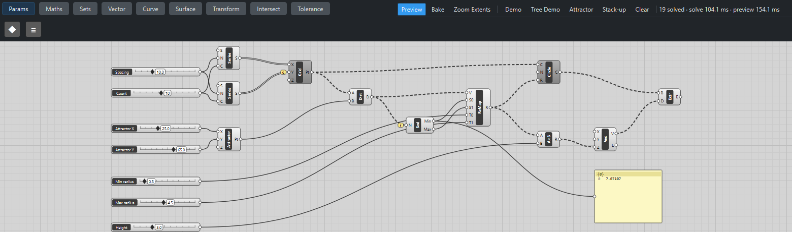
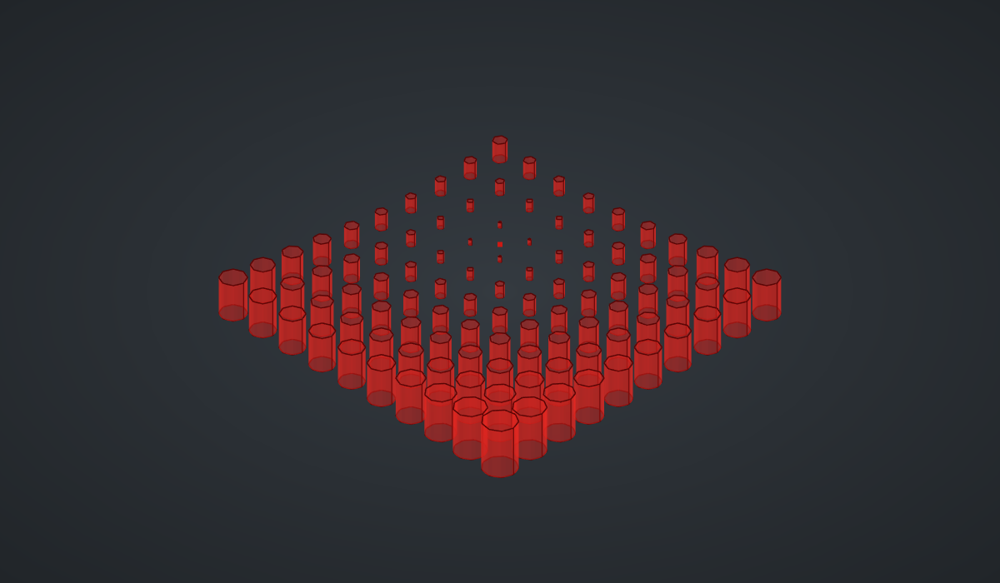
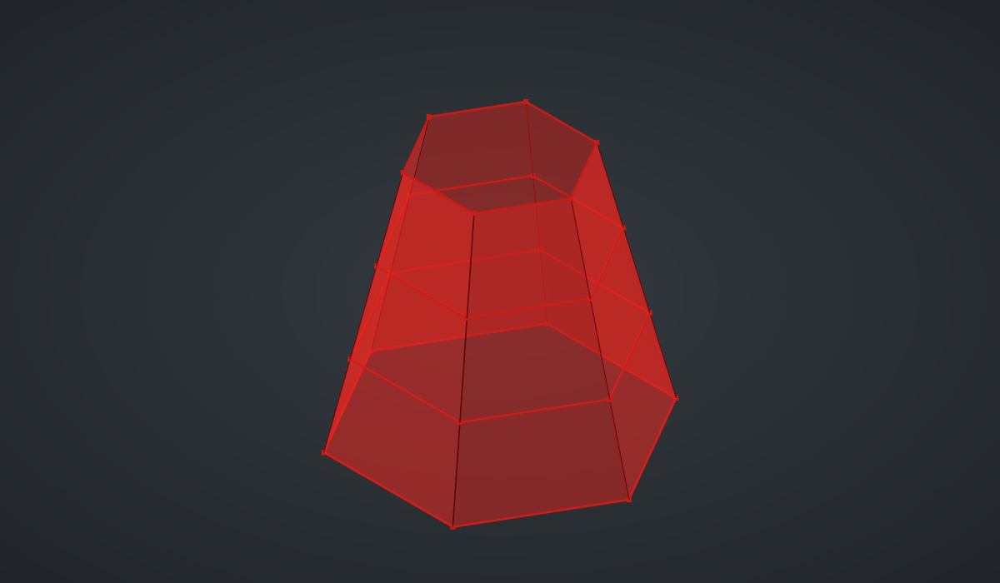
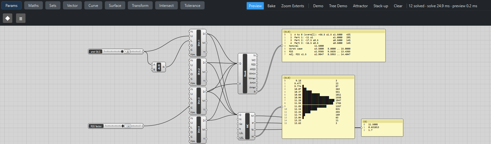

# Katydid

A Grasshopper-style visual programming canvas for [FreeCAD](https://www.freecad.org/), with data trees and tolerance analysis.




Wire components on a node canvas, drag a slider, and the result updates live in FreeCAD's 3D view as a translucent preview. **Bake** turns it into ordinary FreeCAD objects. The canvas is saved inside the `.FCStd` file and comes back when you open it.

Katydid is an independent project. It is not affiliated with Robert McNeel & Associates; Grasshopper and Rhino are their trademarks, used here only to describe the style of tool. All icons and code are original.

**Status:** early but working (v0.1). 48 components, data trees, saving, and a tolerance-analysis tab. Tested on FreeCAD 1.1 on Windows; it should run wherever FreeCAD 1.0+ with PySide6 runs.

## Install

Clone into FreeCAD's user `Mod` folder (run `App.getUserAppDataDir()` in FreeCAD's Python console to find it; on Windows with FreeCAD 1.1 it is `%APPDATA%\FreeCAD\v1-1\Mod`):

```
git clone https://github.com/Foadsf/Katydid.git
```

Restart FreeCAD and pick **Katydid** in the workbench list. The canvas opens as a floating window (it redraws about twice as fast floating as docked). Try **Demo**, **Tree Demo**, **Attractor** or **Stack-up**.

## Using the canvas

| Action | How |
|---|---|
| Add a component | Double-click empty canvas and type, or click or drag an icon from the tabs |
| Wire | Drag from an output grip to an input grip (Shift adds instead of replacing) |
| Remove a wire | Drag it off its input grip and drop it on empty canvas |
| Pan / zoom | Right-drag / mouse wheel (zooms about the cursor) |
| Change a slider | Drag along its rail |
| Flatten / Graft / Simplify / Reverse | Right-click a grip; a yellow F/G/S/R badge marks it |
| Component menu | Right-click a component: Preview, Delete |
| Toggle preview | Select, Ctrl+Q (preview-off components turn darker grey) |
| Delete components | Select, Delete (only canvas components; document objects are safe) |
| Bake | **Bake**: the selected components, or everything previewed if none is selected |

Component colours: grey OK, orange warning (missing input), red error (hover for the message), green selected. Wires: solid for one item, double for a list, dashed for a tree of several branches, thin dashed orange when empty.

## Components (48)

| Tab | Components |
|---|---|
| Params | Number Slider, Panel |
| Maths | Addition, Multiplication, Range, Expression, Remap Numbers, Bounds |
| Sets | Series, List Item, List Length, Cull Pattern, Shift List |
| Vector | Construct Point, Vector XYZ, Vector 2Pt, Deconstruct, Distance |
| Curve | Circle, Circle CNR, Line, Arc 3Pt, Polyline, Interpolate, Divide Curve, Evaluate Curve, Offset Curve |
| Surface | Center Box, Sphere, Cylinder, Loft, Extrude, Pipe, Cap Holes |
| Transform | Move, Rotate, Scale, Mirror, Linear Array |
| Intersect | Solid Union, Solid Difference, Solid Intersection |
| Tolerance | Dimension, Stack-up, Monte Carlo Stack-up, Bonus Tolerance, Virtual & Resultant Condition, Position to ± |

**Expression** formulas are parsed and checked, never passed to Python's `eval`: only numbers, `x`, `y`, `z`, `pi`, `e`, `tau`, arithmetic and math functions are allowed, so opening a shared file cannot run code.

## Data trees

Data flows as trees: branches of items addressed by paths like `{0;1}`. Each input has item, list or tree access. Components match inputs branch by branch (a tree with fewer branches repeats its last one; outputs take the paths of the first input with the most branches) and, within a branch, item by item (longest list). A list output gets a branch per iteration, so dividing three circles in `{0}` gives `{0;0}`, `{0;1}`, `{0;2}`. The Panel lists data under its branch paths.

These rules are my reading of Grasshopper's, written down in `katydid/engine.py`; they have not been checked against Grasshopper itself. Reports of differences are welcome.

**Tree Demo:** stacked circles → Divide Curve (a branch of points per circle) → a closed Polyline per branch → Loft with **Flatten** on its input, so one surface runs through every ring. Turn Flatten off and Loft goes red, because each branch then holds a single curve.



**Attractor:** Grasshopper's classic attractor grid. Two Series and a Graft make a 10 × 10 grid; distance to an attractor point, Bounds (with Flatten) and Remap turn into circle radii; the circles are extruded by their radius. With 100 extruded tubes one update takes roughly 25 ms to solve and 125 ms to mesh the preview, so dragging redraws about 7 times a second; light definitions redraw well over 30 times a second.

## Tolerance analysis

The **Tolerance** tab covers linear stack-ups and GD&T size calculations:

- **Dimension:** nominal, upper and lower deviation, direction in the chain (+1 from A toward B, -1 back), distribution (normal, uniform, triangular).
- **Stack-up:** worst case, RSS and adjusted RSS (RSS × factor, 1.5 by default) with their limits, and a report with each dimension's share of the total. Method after B. R. Fischer, *Mechanical Tolerance Stackup and Analysis*, 2nd ed., CRC Press, 2011.
- **Monte Carlo Stack-up:** random builds of the chain; mean, standard deviation, percentage outside spec limits, and a text histogram. A normal tolerance is k = 3 standard deviations by default.
- **Bonus Tolerance** (MMC, LMC, RFS), **Virtual & Resultant Condition**, **Position to ±**, after G. R. Cogorno, *Geometric Dimensioning and Tolerancing for Mechanical Design*, 3rd ed., McGraw-Hill, 2020.

The maths in `katydid/tolerance.py` is tested against the books' worked examples: Fischer's Examples 4.1–4.4, Figures 8.9–8.14, the Figure 8.15 report (to four decimals) and Example 8.1, and Cogorno's Table 3-2. Where a book rounds an intermediate value, the test says so.

**Stack-up** loads Fischer's Figure 8.9 chain live: drag *±tol 56.5* or *RSS factor* and the limits, the report and the Monte Carlo reject rate (spec 10 to 13) follow.



## Saving

The canvas follows the active FreeCAD document. Its definition is stored as JSON on a **Katydid** object in that document, so it is written into the `.FCStd` file's `Document.xml` and comes back when the file is opened. Edits are written about 0.4 s after they stop and again at the start of every save, so Ctrl+S straight after a slider move still saves it. Double-click the Katydid object in the tree to open the canvas. A component type this version does not know is kept as a red placeholder and saved back unchanged.

## Layout

- `katydid/engine.py`, `tree.py`: components, parameters, data trees and the expire-then-solve solver. No FreeCAD or Qt imports.
- `katydid/components.py`: the component library; `expr.py`: the formula evaluator; `tolerance.py`: stack-up and GD&T maths.
- `katydid/canvas.py`: the Qt canvas, grips, wires, menus, search and tabs.
- `katydid/document.py`, `feature.py`: the saved format and the document object that carries it.
- `katydid/preview.py`, `bake.py`, `gui.py`, `InitGui.py`: the FreeCAD side.

## Tests

Headless, with any Python 3.10+ that has PySide6 (numpy optional), or FreeCAD's bundled Python:

```
python tests/mutate.py
```

This runs the engine, tree, save-format, component and tolerance tests, then breaks ten rules on purpose in a copy of the code and checks that each break is caught.

In FreeCAD (Windows): `python tests/run_gui_tests.py` drives the canvas with real mouse and key events, saves and reopens files in fresh FreeCAD processes, and checks every geometry component against known answers in console FreeCAD. Give it the optional `surfacekit` helper (`KATYDID_SURFACEKIT=<directory>`) and every FreeCAD runs on a private Win32 desktop, so nothing appears on your screen; without it the runner stops unless you pass `--visible`.

## Roadmap

Datum reference frames and datum shift in stack-ups, 2D and angular stacks, undo on the canvas, a radial menu, Param Viewer and Path Mapper, clusters, a script component, and importing Grasshopper `.ghx` files.

## License

LGPL-2.1-or-later, like FreeCAD. See [LICENSE](LICENSE).

Copyright (C) 2026 Foad S. Farimani
